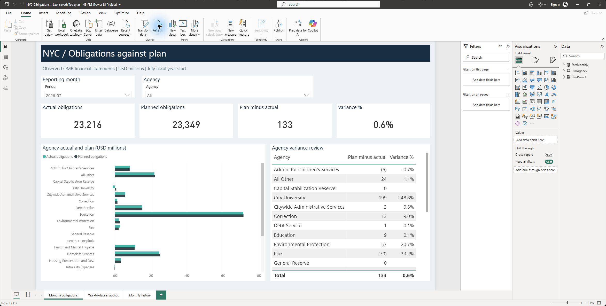
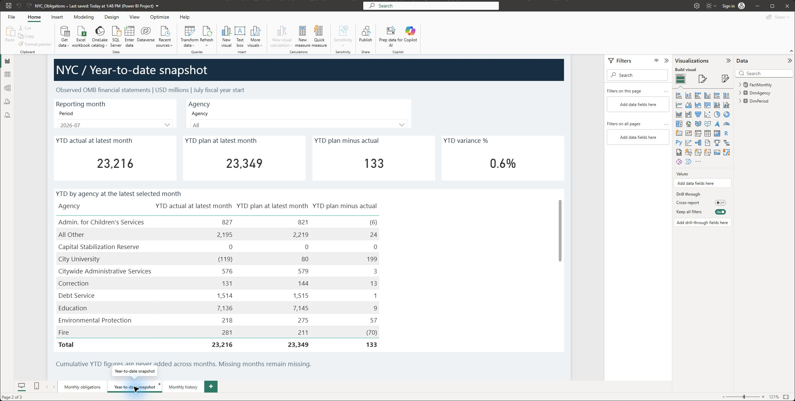
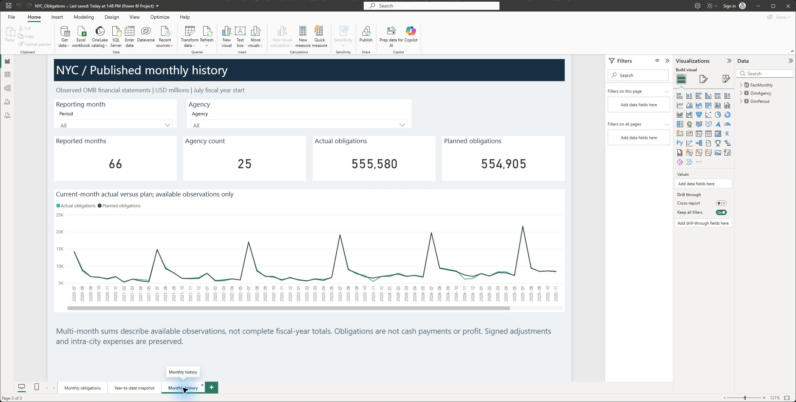

# NYC Financial & Operational Analytics

**3,304 published observations across 66 reporting months.** A reproducible analysis of real public data from [NYC OMB Financial Plan Statements — Obligation](https://data.cityofnewyork.us/d/hjjq-k984). The default reports use observed records, with no synthetic financial or operational fields.



[Dashboard recording](docs/recordings/walkthrough.mp4) · [Screenshot gallery](docs/screenshots) · [Data provenance](docs/DATA_SOURCE.md)

## What the project demonstrates

Current-month obligations, plan-minus-actual variance, and a separate cumulative YTD snapshot. Latest-publication selection prevents revision double-counting. Fiscal years start in July.

## Run locally

Python 3.10+; standard library only. Compressed source snapshots are checked in, so analysis runs offline.

```sh
python scripts/verify_source.py
python src/build.py
python src/build_powerbi.py
python -m unittest discover -s tests -v
```

Open `reports/dashboard.html` in a browser. Generated SQLite databases are excluded from Git to keep the repository compact; running the pipeline recreates them from the full source. No sampled subset is substituted for the full extract.

## Open in Power BI

Open [NYC_Obligations.pbip](powerbi/native/NYC_Obligations.pbip) in Desktop and click **Refresh**. Sample observations are embedded in M partitions; no machine-specific path or credentials are required. Four tables, four relationships, ten DAX measures and three pages separate monthly facts from cumulative snapshots.

[Native DAX validation](reports/powerbi_validation_results.json) compares all 1,628 agency/month combinations to SQL and verifies that YTD grand totals use the latest selected period, not a sum of snapshots. Desktop validation is local; CI regenerates model files and tests Python/SQL, not the Desktop application.





## Analytical scope

No revenue, profit, inventory, delivery data or complete annual expense totals are claimed. June and other missing observations are not filled. Amounts are source-rounded USD millions.

## Reviewable files

- `data/source/`: compressed full source snapshot, source URL, retrieval timestamp and checksums.
- `src/` and `sql/`: transformations, reporting calculations and local rendering.
- `reports/`: computed summaries, validation results and source-quality evidence.
- `tests/`: edge-case tests for the actual source semantics.
- `docs/`: methodology, screenshots and an automated browser walkthrough.

The earlier synthetic demonstration remains in Git history. Current outputs and screenshots were rebuilt from these public sources; recordings demonstrate the reports, not a person's development session.
