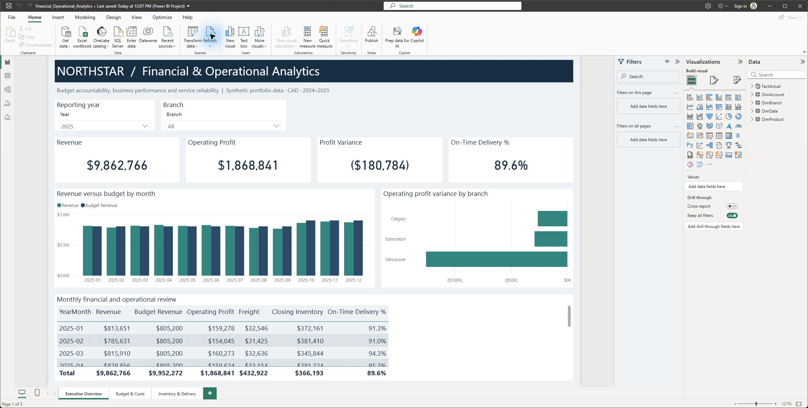
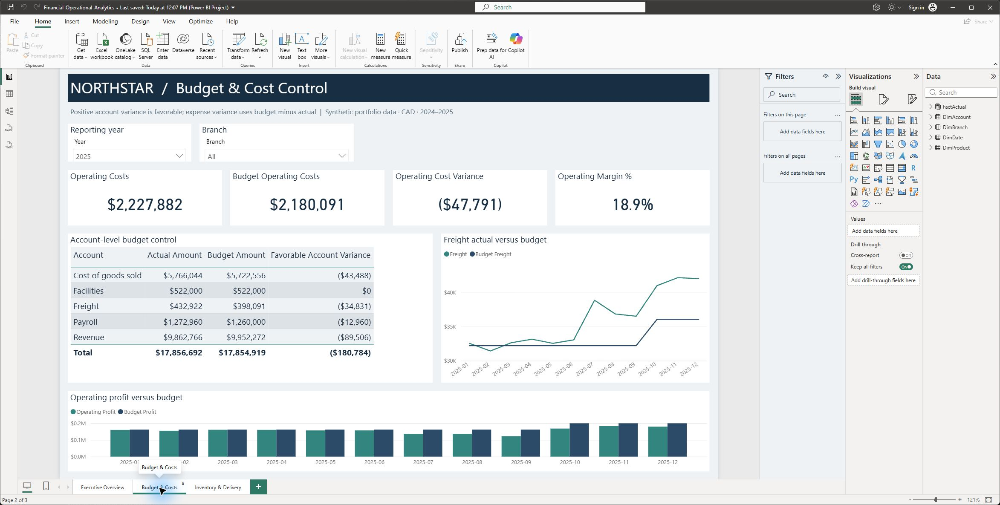
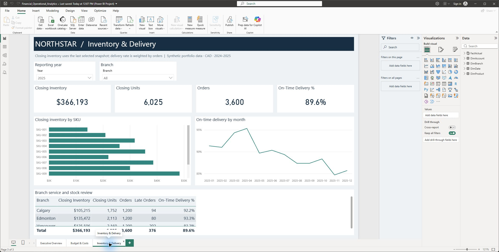

# Financial & Operational Analytics Dashboard

A reproducible portfolio project for a fictional Canadian distributor. An editable native Power BI project includes 8 tables, 11 relationships, 28 DAX measures and 3 report pages. Python and SQL prepare the data and independently verify the results. All data and business findings are synthetic. The model was refreshed in Power BI Desktop and passed 18 native DAX-to-SQL checks.


[Recorded walkthrough](docs/recordings/walkthrough.mp4) · [Screenshot gallery](docs/screenshots) · [Capture details](docs/recordings/capture_manifest.json)

## Start here

Open `reports/dashboard.html` in a browser. It works offline and filters by year and branch. Read `reports/management_brief.md` for computed findings and recommendations. Open `powerbi/native/Financial_Operational_Analytics.pbip` in Power BI Desktop and click Refresh. Embedded sample CSVs make the project portable. See [native validation results](reports/powerbi_validation_results.json).

To regenerate everything from deterministic source data, run from this folder:

```powershell
python src/build.py
python src/build_powerbi.py
```

Python 3.10+; standard library only, no packages or credentials. Running again replaces the generated database, CSV exports, dashboard, brief and validation log. Source SQL, DAX and documentation are preserved.

## Business problem

Management needs to understand budget performance, cost pressure, delivery reliability and inventory exposure across Edmonton, Calgary and Vancouver. Separate financial, order and inventory tables can cause duplicated totals when joined at inconsistent grains. The solution aggregates facts independently and uses shared date and branch dimensions.

## Deliverables

| Folder | Contents |
|---|---|
| data/raw | Generated relational source tables, including deliberately dirty ledger data |
| data/model | Eight clean dimension/fact CSVs for Power BI |
| data/analytics.sqlite | Runnable relational source and reporting database |
| sql | SQL deduplication, quarantine, transformation and reporting view |
| powerbi | Import function, measures, theme, relationships and report specification |
| reports | Interactive browser dashboard, computed management brief, exception log and test results |
| src | Reproducible data generator and dashboard template |
| docs | Data dictionary and first-person project walkthrough |

## Data and metric conventions

Coverage: January 2024–December 2025. CAD only; no FX or tax. Financial amounts are integer cents in storage and dollars in reports. Revenue and expenses are positive magnitudes; operating profit = revenue − COGS − operating expenses. On-time delivery includes all simulated orders and uses shipped date <= promised date. Inventory is stock at month-end, with a standard unit cost; it is not inventory movement or a turnover calculation.

The seeded scenario adds Vancouver second-half 2025 revenue pressure, freight costs and delivery delays plus higher stock in three SKUs. These are scenario assumptions, not independent discoveries about an actual company.

## Quality and reproducibility

The raw ledger includes an exact duplicate, unknown branch and missing amount. SQL removes the duplicate from reporting and quarantines the invalid records without overwriting raw data. Validation reconciles cents, keys, snapshot values, order classifications and monthly totals. See the generated JSON log for executed checks. All 28 measures executed in Desktop; 72 branch-month combinations, weighted delivery ratios and year-end inventory were checked against SQL.

This is a management reporting simulation, not an accounting system. It does not implement a balanced general ledger, journal reversals, security roles, incremental refresh, publishing, or production scheduling. Do not describe those as completed work.

## Native Power BI screenshots

These captures show the model running in Desktop.






